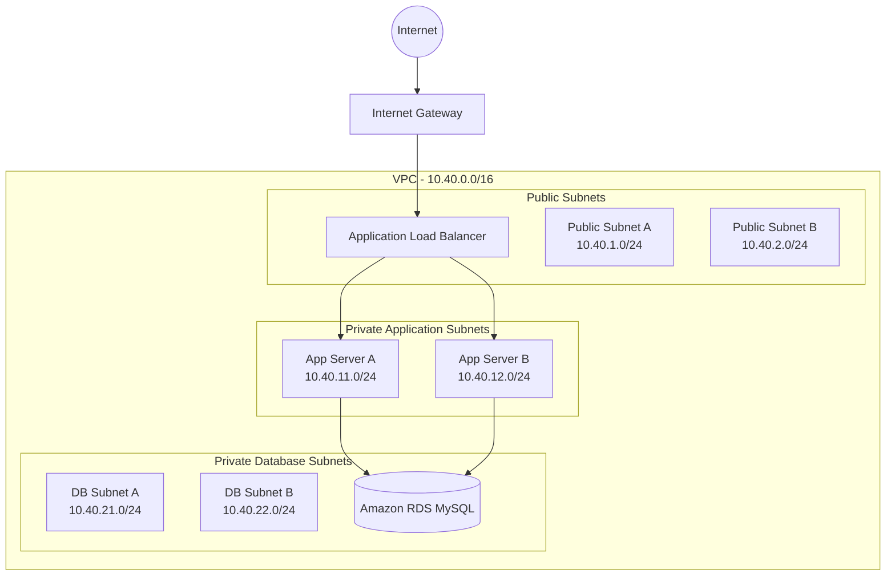

# AWS 3-Tier Infrastructure Deployment Using Terraform

## Project Overview

This project demonstrates the deployment of a three-tier infrastructure architecture on Amazon Web Services (AWS) using Terraform.

The infrastructure separates the public-facing load balancer, application servers and database into distinct network tiers. It uses private subnets, security groups and an Application Load Balancer to demonstrate fundamental AWS networking, compute, database and Infrastructure as Code (IaC) concepts.

**AWS Region:** `ap-southeast-2` (Sydney)

**Infrastructure as Code:** Terraform

## Architecture



## Infrastructure Components

| Component | Configuration |
|---|---|
| VPC | `10.40.0.0/16` |
| Availability Zones | `ap-southeast-2a`, `ap-southeast-2b` |
| Public Subnets | 2 |
| Private Application Subnets | 2 |
| Private Database Subnets | 2 |
| Load Balancer | Application Load Balancer |
| EC2 Instances | 2 × `t3.micro` |
| Database | Amazon RDS for MySQL |
| Database Instance | `db.t3.micro` |
| Database Storage | 20 GB gp3 |
| NAT Gateway | Not deployed |

## Key Features

- Custom VPC with a segmented six-subnet architecture.
- Multi-AZ public and private subnet deployment.
- Internet-facing Application Load Balancer.
- Two EC2 application servers deployed without public IP addresses.
- Target group health checks and load distribution.
- Private Amazon RDS MySQL database.
- Security groups using resource-to-resource references.
- Terraform-managed infrastructure and reusable variables.
- EC2 application bootstrap using a user-data script.

## Network Security

| Security Group | Inbound | Outbound |
|---|---|---|
| ALB | HTTP TCP 80 from `0.0.0.0/0` | TCP 80 to App SG |
| Application | TCP 80 from ALB SG | TCP 3306 to DB SG |
| Database | TCP 3306 from App SG | No custom egress rules |

Additional security decisions:

- EC2 instances do not have public IP addresses.
- RDS is configured as non-publicly accessible.
- Application and database subnets have no default Internet route.
- Database credentials are supplied through a local, Git-ignored Terraform variables file.
- Database password variable is marked sensitive.

## Project Structure

```text
aws-3tier-terraform/
├── scripts/
│   └── userdata.sh
├── terraform/
│   ├── .terraform.lock.hcl
│   ├── main.tf
│   ├── outputs.tf
│   ├── providers.tf
│   ├── variables.tf
│   ├── terraform.tfvars.example
│   └── terraform.tfvars
├── .gitignore
└── README.md
```

Note: `terraform.tfvars` is a local configuration file and must not be committed to Git.

## Prerequisites

- AWS account with appropriate IAM permissions.
- AWS CLI configured with credentials.
- Terraform CLI (version 1.5.0 or later).
- Git.

## Deployment Instructions

### 1. Clone the repository

```powershell
git clone <YOUR-GITHUB-REPOSITORY-URL>
cd aws-3tier-terraform/terraform
```

### 2. Initialize Terraform

```powershell
terraform init
```

### 3. Configure variables

```powershell
Copy-Item terraform.tfvars.example terraform.tfvars
```

Update `terraform.tfvars` with your own database username and a strong database password.

Do not commit this file.

### 4. Validate the configuration

```powershell
terraform fmt -check
terraform validate
```

### 5. Review the deployment plan

```powershell
terraform plan
```

### 6. Deploy the infrastructure

```powershell
terraform apply
```

Review the proposed resources before confirming deployment.

### 7. Retrieve Terraform outputs

```powershell
terraform output
```

## Verification and Testing

| Test | Result |
|---|---|
| Terraform validation | Passed |
| Terraform plan consistency | Passed |
| EC2 instance status checks | 3/3 checks passed for both instances |
| ALB target health checks | Both targets healthy |
| Application HTTP response | HTTP 200 OK |
| Load balancing | Requests served by both application servers |
| RDS availability | Available |
| RDS public accessibility | Disabled |
| Application-to-RDS TCP connectivity | Successful |

A temporary Lambda connectivity test inside the VPC successfully established a TCP connection to the private RDS endpoint on port 3306.

This verified DNS resolution and network connectivity, but did not verify MySQL authentication or SQL query execution.

The temporary Lambda test resources were removed after verification.

## Design Decisions and Limitations

- **No NAT Gateway:** Omitted to reduce lab operating costs. Private application instances do not have outbound Internet access through the VPC.
- **Single-AZ RDS deployment:** Multi-AZ is disabled to reduce costs. The database does not provide Multi-AZ high availability.
- **Default Network ACL:** The default permissive NACL is retained. Resource-level traffic restrictions are primarily enforced through security groups.
- **Demonstration application:** The Python HTTP server is a simple demonstration service, not a production application.
- **Database integration:** TCP connectivity was verified, but application-level MySQL authentication and queries were not implemented.
- **Database deletion:** The lab uses `skip_final_snapshot = true`. Destroying the database does not create a final snapshot.

These decisions were made to balance practical infrastructure learning with lab cost.

## Cleanup

To remove the deployed AWS resources:

```powershell
terraform destroy
```

Review the destruction plan carefully before confirming.

**Important:** This destroys the infrastructure, including the RDS database. Since final snapshots are disabled, database data will be lost.

## Skills Demonstrated

- AWS VPC and subnet architecture
- Public and private network segmentation
- Internet Gateway and route table configuration
- AWS Security Groups
- Amazon EC2
- Application Load Balancing
- Amazon RDS for MySQL
- Terraform Infrastructure as Code
- AWS CLI
- Infrastructure validation and troubleshooting
- Network connectivity testing

---

**Project:** AWS 3-Tier Infrastructure Deployment Using Terraform
**Author:** Jared
